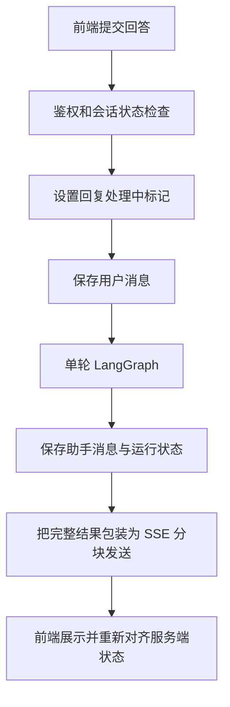

# 01 项目全貌：沿着一场面试看系统

## 1. 先认识五种不同的数据

简历是候选人提供的材料，不是已经证实的能力；配置说明希望练什么；计划定义本场准备考什么；消息保存实际说了什么；工作记忆记录从回答中提取出的证据与缺口。最终报告综合计划、证据和消息，形成对本场表现的反馈。

这几类数据不能互相代替。简历写“熟悉 Redis”不能直接进入高分依据；某主题已经切过，不能表示该主题所有信号已经验证；消息存在也不能表示证据抽取一定成功。

## 2. 完整案例的八个时刻

以下是教学推演，具体生成内容不保证与真实模型一致。

| 时刻 | 用户看到什么 | 后端发生什么 | 应保留的数据 |
|---|---|---|---|
| 上传 | 简历解析结果 | 提取文件文本，结构化解析 | 简历原文和结构化字段 |
| 配置 | 岗位、语言、类型、JD | 校验配置与简历归属 | 会话配置快照 |
| 规划 | 主题摘要 | 模型生成、校验、必要时重试或降级 | 计划版本、生成来源 |
| 确认 | 已锁定计划 | 固定计划 ID | confirmed_plan_id |
| 开始 | 第一题 | 校验状态、扣额度、初始化运行态 | 开场消息、运行状态 |
| 回答 | 处理等待与新问题 | 保存回答，执行单轮图，保存结果 | 消息、决策元数据、工作记忆 |
| 结束 | 评估准备 | 状态进入 evaluating | 结束原因、剩余时间快照 |
| 评估 | 报告与建议 | 规则评分、叙事增强、记录学习结果 | 报告、有效场次快照、档案 |

创建会话时已经同步生成首版计划。不要因为存在 `planning` 状态，就推断系统有独立后台任务队列。

## 3. 一次回答到底经过哪里

在教学案例中，候选人说“我用 Lua 保证 Redis 内的检查和扣减一起完成”。系统需要判断这句话支持哪个计划信号，以及仍缺什么。它可以追问 Redis 与订单数据库之间的一致性，但不能仅因提到了 Lua，就认为整个库存方案已经正确。

## 4. 三个 Agent 如何协作

Planning 产出计划，Interview 执行计划并积累证据，Evaluation 解释本场结果。它们由 Python 服务层直接调用，不是三个独立部署、互发 HTTP 请求或自主协商的智能体。

“多 Agent”的价值主要在职责与输入输出边界：规划关注考察安排，对话关注当前下一步，评估关注已有证据。文件夹拆分本身不代表复杂的分布式协作。

## 5. 一场面试的状态

主线为 `planning → plan_ready → plan_confirmed → active → evaluating → completed`。重新生成计划停留在规划预览阶段；确认不会自动开始面试；结束不会自动等于报告已经生成，评估有独立入口。

前端页面地址不能代替业务状态。例如直接输入对话页 URL，仍需后端确认会话已经激活。反过来，页面关掉也不等于数据库里的面试结束。

## 6. 为什么读懂全局比背模块重要

假如报告缺少一条证据，应依次确认：回答有没有存；消息主题是否正确；该轮是否进入抽取分支；抽取内容是否通过原话和信号校验；工作记忆是否合并落库；评估是否正确投影；前端是否展示。这个定位顺序来自数据流，而不是猜测“模型是不是不好”。

## 核对与自测

入口：`backend/app/api/routes/interviews.py`。服务：`interview_planning_service.py`、`interview_agent_service.py`、`interview_evaluation_service.py`，均在 `backend/app/services/` 下。

练习：从“用户提交回答”讲到“报告引用原话”，标出每次持久化的位置。再说明如果浏览器中途关闭，哪些数据已经存在，哪些处理仍需重新查询确认。
