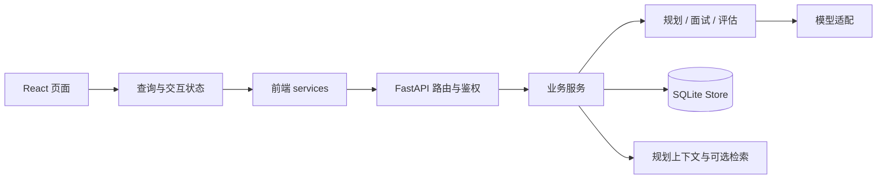

# 04 系统架构：职责、状态与一致性

## 1. 分层怎样落实

浏览器通过 `/api` 请求 FastAPI。路由层负责协议、请求模型与用户依赖；服务层负责业务前置条件、加载上下文、调用 Agent、保存结果；Agent 层负责规划生成或单轮工作流；模型层封装 Provider；Store 负责 SQLite。

这张图表达依赖方向，不表示每个模块都是独立服务。一个 trace_id 也不是已经接入分布式追踪平台。

## 2. 三种状态必须分开

**业务状态**决定允许哪些操作，例如 plan_ready 才能确认，active 才能回答，evaluating 才能首次生成报告。`SessionState` Enum 集中定义 6 个状态 + 合法转换表，非法转换通过 `assert_transition` 抛 409。`store` / service 层不再使用字符串字面量比较，统一走 `coerce()` + Enum 等值。

**运行状态**保存当前主题、回答轮数、追问次数、截止时间、主题摘要、工作记忆和处理标记。它存入 workflow_state_json，支持下一次请求继续推进。

**前端临时状态**包括输入框、是否正在打字、当前流式片段和弹窗。它可以被刷新清除，不能作为服务端是否完成处理的唯一依据。

因此“按钮被禁用”只改善操作体验，后端状态校验才保护业务规则；但后端读状态再写状态仍可能有竞态，需要数据库条件更新才能提供更强的并发保证。

## 3. 计划契约的具体含义

内部计划包含主题 ID、名称、维度、目标、开场题、考察信号、追问策略与评价标准等。稳定 ID 用于连接消息、证据和报告，而不是靠主题标题字符串碰巧相同。

确认时先更新计划记录状态，再更新会话状态与 confirmed_plan_id。后续执行读取指定版本。用户重新生成是在确认之前创建新版本，不是在正式面试中覆盖旧契约。

“只读”在这里首先是业务约束，不能由此推断数据库有不可变触发器或所有状态更新合成单事务。

## 4. 单轮请求中的持久化边界

回复开始时先保存 reply_in_progress；之后保存用户消息；执行图；保存助手消息；更新运行态与会话状态；最后发送展示流。每一步都可能失败。

例如用户消息已提交，但图执行抛异常：原话可能已经存在，异常处理会尝试清理处理中标记，但不会自动回滚之前所有操作。若助手消息已写入而运行态更新失败，也可能出现消息与进度不一致。

这些属于根据提交边界识别的故障风险，不是声称已经发生过的线上事故。修复思路是把关键本地提交设计成原子步骤，给回答引入请求 ID 与版本约束，并定义失败后读取与重试协议。不要为等待外部模型而持有长数据库事务；可以先登记任务，再在短事务内提交计算结果。

## 5. 图状态与恢复能力

单轮图状态是本次计算中的上下文。跨轮恢复依赖服务层保存的运行快照。数据库里的消息是对话记录，工作记忆是证据投影，两者互补。

当前没有证据表明每个节点都有持久检查点，因此进程在抽取后、保存前终止时，不能保证从抽取完成的位置继续。若需要可靠后台处理，应考虑任务记录、状态版本、重试语义和可重放输入，而不是只更换图框架配置。

## 6. 架构中最重要的不变量

一场正式面试引用一个确认计划；消息和证据关联合法主题；非法动作不能直接执行；未验证主题不硬填分数；完成报告可以重复读取；学习档案只汇总符合条件的场次。

每个不变量都应有对应的服务检查、数据约束或测试。若仅写在 Prompt 中，就只是要求模型遵守，尚未形成可靠系统边界。

**订阅与配额不变量**：
- 注册时新用户 `quota_remaining = 1`、`tier = 'free'`、`membership_status = 'free'`
- 充值入账后 `tier` 提升到 `paid`（单包）或 `subscription`（月卡）+ `subscription_expires_at`；`membership_status` 由 `apply_payment_to_user` 同步更新
- 订阅有效时（`is_subscription_active(user)` 显式 `datetime.now(timezone.utc)` 比较）激活面试不扣 quota；`effective_quota_remaining` 返回 `None`（语义 = 无限）
- 订阅过期时 `sync_subscription_status` 把 `membership_status` 降级为 `expired_subscription` + 清 `tier`

**配置与认证不变量**：
- `include_algorithm=true` 时不改变主对话流；算法回合分数仅在 live page 侧栏展示，不写 messages
- `target_role='__custom__'` 时 `custom_target_role` 必填；`duration_minutes` 取 `[15, 30, 45, 60]` 之一
- `username` 在注册/登录入口 `strip().lower()` 归一；schema 加 `_no_blank` field validator 拒绝纯空白 username/password
- 401 由 `services/client.ts` 的 `unauthorizedHandler` 统一处理（清 token + 写 `offer-agent-return-path` + 跳 `/`）；非 401 错误保留登录态
- 密码新用户用 argon2；老用户 PBKDF2 12 万轮 hash 仍可验证，登录成功后惰性 rehash 升级

**语言与会话不变量**：
- `interview_language ∈ {"en", "zh"}`，per-session 独立，控制 LLM 在规划/面试/评估三段的输出语言；`configuration_json` 无该字段时 fallback `en`
- `LocaleMiddleware` 解析 `Accept-Language` 头（只接受 `en` / `zh`，其它 fallback `en`）；`get_locale(request)` 注入依赖；options / errors 按 locale 选 `label_en` / `label_zh`，错误体带 `i18n_key` 但**不**返 message
- `i18next` 同步初始化后再 `createRoot`，避免首屏闪；`useLocale` 读 `document.documentElement.lang` 供 `Intl.*` 使用；`formatDateTime` / `toLocaleString` 显式 `timeZone: 'Asia/Shanghai'`

**事件与状态传播不变量**：
- 进程内 `EventBus`（`asyncio` pub/sub，dict[str, WeakSet[asyncio.Queue]]）单进程假设下向订阅者推送领域事件；典型用途是评估完成时 `evaluation_done` 推给 live page
- 领域事件名集中在 `app.core.events`（`INTERVIEW_ACTIVATE_COMMITTED` / `QUOTA_DECREMENTED` / `EVALUATION_COMPLETED` / `PLAN_CONFIRMED_ATOMIC` / `REPLY_USER_MESSAGE_PERSISTED` 等），便于 grep 与后续接入 OpenTelemetry
- 多 worker 部署需换 Redis Streams；当前 SSE channel 是进程内单点

## 核对与自测

源码：`backend/app/services/interview_agent_service.py`、`backend/app/services/interview_planning_service.py`、`backend/app/agent/interview/state.py`、`backend/app/db/store.py`、`backend/app/core/session_state.py`、`backend/app/core/locale.py`、`backend/app/core/events.py`、`backend/app/services/events.py`、`backend/app/services/billing_service.py`、`backend/app/services/auth_service.py`。

练习：画出“助手消息已保存，但客户端没收到 done”的时序。说明为何重新读取会话通常比立即重发回答更稳妥，以及当前没有请求幂等键时仍有哪些不确定性。
