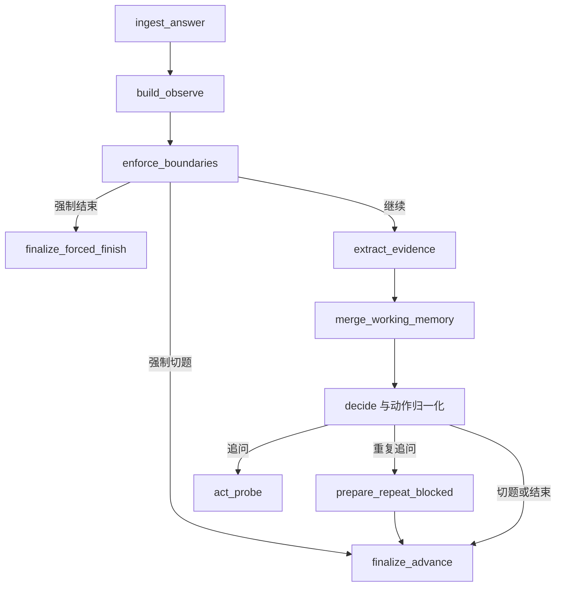

# 05 面试 Agent 核心：一次回答怎样成为下一步行动

## 1. 先把三层责任讲清楚

Observe 组装上下文，Decide 选择结构化动作，Act 把动作表达成自然语言。Observe 节点本身没有独立调用 LLM。证据抽取是另一个模型操作，位于正常路径的边界检查之后、Decide 之前。

拆分解决的是职责混杂：如果追问方向不合适，可以检查决策输入和动作；如果方向对而表达差，可以检查 Act；如果误认为某信号已经覆盖，可以检查抽取与合并。拆分不会自动保证任一层语义正确。

## 2. 从服务层进入工作流

用户提交库存方案回答后，服务先验证用户归属、会话 active、没有已知回复处理中标记，再设置标记并保存原话。它加载确认计划、简历、配置、运行态和消息，调用 ReplyHandler，后者为单轮图构造初始状态并 invoke。

图的 ingest 节点增加总回答轮数和当前主题回答轮数，再从消息元数据中筛选本主题对话。这里的“轮数”按用户回答计，不是把用户和助手两条消息分别算一轮。

## 3. 完整控制流

这是当前实现的顺序。不要把“概念上的 ODA”当作节点的完整清单，也不要漏掉绕过抽取的边界分支。

## 4. 硬边界究竟怎样判断

v1 阶段常量写死为 45 分钟。**v2.2 起**改为读 `session.configuration.duration_minutes`（15/30/45/60 之一），由 `ensure_interview_clock_started` 注入 deadline；其他约束保持：最后 5 分钟进入收尾区、总回答最多 12 轮、单主题最多 3 轮回答、最多 2 次追问。检查优先级是：到期 → 总轮数 → 收尾区 → 单主题轮数 → 追问次数。

优先级有实际含义：已经到期时，不应因为仍有未问主题而继续；在收尾区则根据必考覆盖和是否还有主题决定结束或切题。这里 required_topics_covered 使用 completed_topic_ids；它代表流程完成记录，不是证据层全部信号都已验证。

计数在边界检查前增加。因此第 12 次回答会触发总轮数结束，第 3 次主题回答可能触发切题；它们不是“第 13 次才拒绝”。这也引出当前缺口：这些回答已经保存，却可能不经过本轮证据抽取。结束节点会生成主题摘要，但摘要不能自动补成同等的结构化证据。

另一个边界是时钟触发方式：后端在读取／回复相关流程中维护时钟、在单轮图内检查边界，不能由此声称存在独立定时任务在到期瞬间关闭所有空闲会话。激活和真正启动计时的细节由 runtime_state 中 ensure_interview_clock_started 决定。

## 5. 库存回答怎样影响下一问

教学输入：“我负责扣减逻辑，用 Lua 把库存检查和扣减放在 Redis 内完成。”假设计划要求个人贡献、原子性、跨系统一致性三个信号。

抽取可以得到与原子性和个人贡献关联的原话；校验通过后进入记忆。剩余缺口包括跨系统一致性。Decide 可能选择 probe_risk，期望获取“Redis 扣减成功但订单写入失败如何处理”。Act 再把这一目标转成一句问题。

这个动作是示例，不是固定输出。真实模型也可能判断先追问具体实现。系统的确定性边界是动作是否合法、是否超限、是否仍在当前主题，而不是保证每次都选中唯一最优追问。

## 6. 模型返回的动作为什么不能直接执行

normalize_decision 限制动作集合，把目标主题约束为当前主题，整理 reason 和 expected_information，并统一切题标记。存在下一主题时，模型的 finish 会改成 next_topic；没有下一主题时，next_topic 会变成 finish。

这意味着模型不能任意跳到某个主题，也不能在仍有后续主题时仅凭自己判断直接正常结束。业务控制权留在代码中。

重复追问保护比较本次 expected_information 的第一项与上次记录的字符串；相等时阻止重复追问并进入推进路径。这是精确字符串保护，不能识别所有语义相同的不同说法。若要升级，可先定义稳定 signal ID，再比较信号而非自由文本，但需同步修改计划与记忆协议。

## 7. 记忆为什么分层

短期上下文保留本主题近期消息，帮助模型理解上一问与这一答的关系；主题摘要保存已完成方向的概况；工作记忆保留跨轮的 claims、evidence、risks、contradictions 与缺口；长期学习档案则跨场次聚合。

Decide 的上下文有消息数量和字符数限制。当前裁剪是移除最旧消息，默认最多 12 条、4000 字符；不是 tokenizer 的精确 token 预算。如果单条消息过长，整条都可能被移出裁剪结果。最新回答另有字段，但其他节点是否也受同样限制，需要逐调用检查，不能说“整个系统所有 Prompt 都被统一限制”。

三层记忆是不同用途的数据结构，不等于三个向量数据库。持久原话用于追溯，结构化记忆用于决策，两者不应互相替代。

## 8. 降级怎样影响行为

抽取失败返回空增量；合并保留已有记忆并重新计算缺口。Decide 失败尝试规则决策，Act 失败尝试模板提问。这样可提高流程继续推进的机会，但无法保证新回答已经被理解或仍有同等练习价值。

还要注意异常作用域：部分 client 创建位于调用层的 try 之外，不能把所有配置或初始化错误都描述成必定降级。真实可恢复范围必须结合工厂和上层异常处理验证。

## 9. 性能与可解释性的交换

正常追问可能串行包含抽取、Decide 和 Act；切题时还涉及摘要、过渡等处理。应记录分阶段耗时，再决定减少调用、压缩输入、使用不同模型或异步补充证据。把抽取和决策随意并行会使决策读不到新证据，改变业务语义。

优化前应保持一组固定回答与期望信号，比较追问质量和报告覆盖。只比较总耗时容易以质量下降换来表面提速。

## 10. v2.2：算法回合

当 `configuration.include_algorithm=true` 时，live page 头部出现"Algorithm Round"按钮；点击打开右侧 side panel，内嵌 `AlgorithmTurn` 组件。

算法回合不进入主对话流（**不**写 messages 表），仅作为本场内的辅助手写环节：

- 题库来自 `backend/app/data/algorithm_problems.py`（5 道经典题：two_sum / reverse_linked_list / valid_parentheses / max_subarray / lru_cache），含隐藏测试用例
- LLM judge 强约束 JSON-only 输出；解析失败回 `verdict=unparsed`，前端展示"暂时无法解析"提示而非 5xx
- 评分维度 correctness / efficiency / style / edge_cases（各 1-5）+ 整体 overall + 1-2 句 feedback
- 用户可重置 / 多次提交；每次结果只更新 React state，不写 DB

算法回合的设计目的：让候选人获得代码级别的练习反馈，而面试官 Agent 仍以对话形式考察设计取舍。两条流在时间线上并行（用户在某轮对话间穿插手写代码），但产物完全独立。

## 核对与自测

源码：`backend/app/agent/interview/graph.py`、`nodes/ingest.py`、`nodes/finalize.py`、`nodes/merge_working_memory.py`；边界与动作位于 `backend/app/services/interview/boundaries.py`、`actions.py`。

测试入口：`backend/tests/test_interview_actions.py`、`test_interview_agent_step4_step5.py`、`test_interview_memory_step2.py`。

推演：回答轮数从 11 变 12 时经过哪些节点？原话还在吗？为什么报告仍可能缺少本轮证据？这三个问题能够检查是否真正读懂执行顺序。
